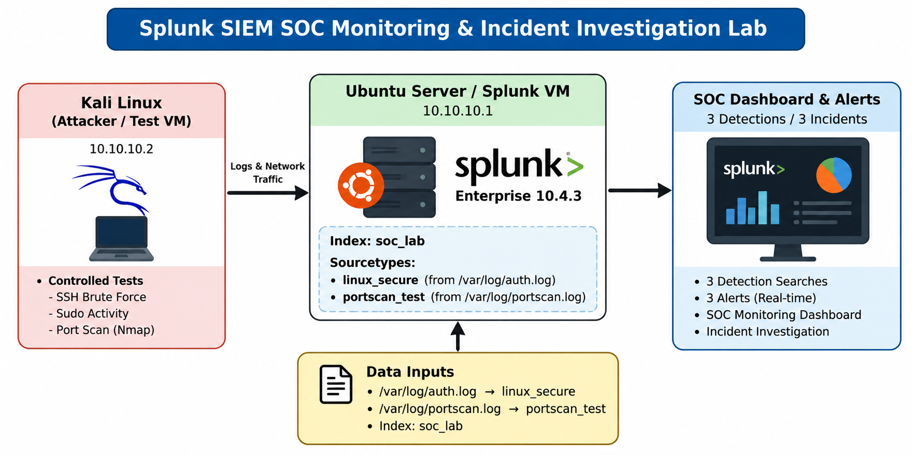

# Splunk SIEM SOC Monitoring & Incident Investigation Lab

## Overview
A practical VMware-based SOC lab built with Splunk Enterprise, an Ubuntu Server Splunk VM, and Kali Linux as the controlled test source.

The lab demonstrates:
- Linux authentication log ingestion into Splunk
- Detection engineering with simple SPL
- Scheduled SOC alerts
- Incident triage and evidence collection
- Network telemetry for controlled port-scan detection
- SOC dashboarding

## Lab Architecture

The lab architecture is shown below:

## Lab Architecture
- Splunk VM: Ubuntu Server 24.04
- Splunk Enterprise: 10.4.3
- Splunk Web: 10.10.10.1:8000
- Kali test source: 10.10.10.2
- Lab interface on Splunk VM: ens38
- Primary index: `soc_lab`

## Data Sources
1. `/var/log/auth.log` — sourcetype `linux_secure`
2. `/var/log/portscan.log` — sourcetype `portscan_test`

## Incidents
- INC-001 — SSH Failed Authentication
- INC-002 — Repeated Sudo Privilege Activity
- INC-003 — Network Port Scan

All activity was intentionally generated in the isolated lab environment.

## Detection Searches
See `searches/` and `detections/`.

## Evidence
Screenshots are stored under `screenshots/`. Only screenshots that were captured and available in the working session are included; no evidence image is fabricated.

## Project Outcome
The lab demonstrates an end-to-end SOC workflow:
Data Collection → Detection → Alert → Triage → Investigation → Evidence → Incident Documentation.
